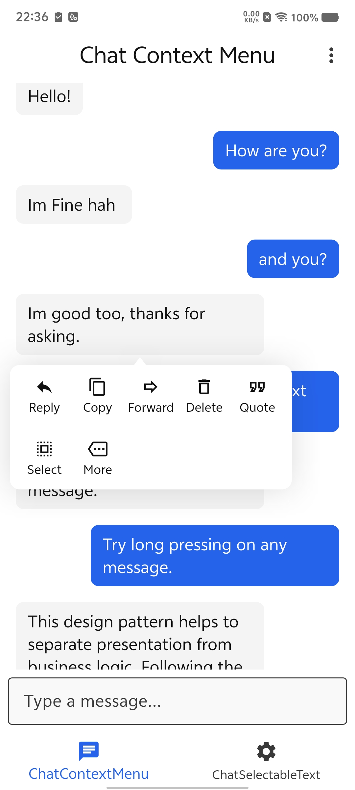
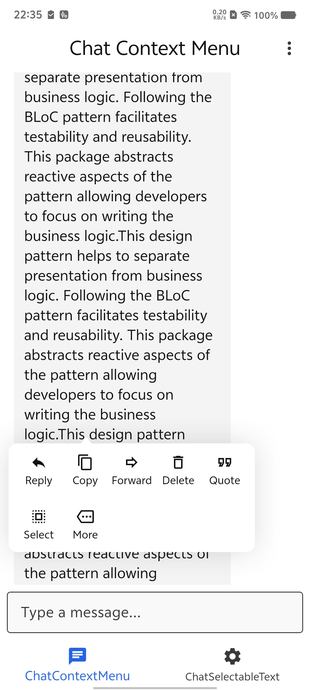
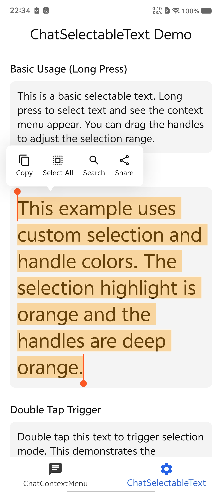

# Chat Context Menu

[](README_ZH.md)

A Flutter package that provides an iOS-style chat context menu with customizable appearance and animations. This package handles the positioning, arrow indicator, and background dimming/cutout, allowing you to provide any widget as the menu content.

**Live demo:** https://matkurban.github.io/chat_context_menu/

## Features

*   **iOS-style Context Menu:** Smooth animations and layout similar to native iOS context menus.
*   **Two Positioning Modes (`ChatContextMenuPositionMode`):**
    *   `ChatContextMenuPositionMode.outside` (default): Places the menu outside the target widget or text selection bounds, automatically falling back to the press position when the widget/selection is taller or wider than the available screen space.
    *   `ChatContextMenuPositionMode.pointer`: Anchors the menu directly at the mouse click or touch press position with the arrow pointing to the clicked coordinate (supported on both `ChatContextMenuWrapper` and `ChatSelectableText`, across `Axis.vertical` and `Axis.horizontal`).
*   **Arrow Indicator:** An arrow points to the target widget, selection, or clicked coordinate and automatically stays clear of rounded corners.
*   **Vertical & Horizontal Layouts:** Place the menu above/below (`Axis.vertical`) or to the left/right (`Axis.horizontal`) of the anchor.
*   **Customizable Appearance:** Configure background color, border radius, padding, shadows, arrow dimensions, and barrier color.
*   **Flexible Content & Triggers:** You provide the widget for the menu content and bind any trigger gesture (`onLongPress`, `onSecondaryTap`, `onTap`, `IconButton`, etc.) via `widgetBuilder`'s `showMenu` / `hideMenu` callbacks.
*   **Selectable Text (`ChatSelectableText`):** Fully custom text selection built from the ground up (`RichText` + `TextPainter` + `OverlayEntry`) with draggable handles, auto-scroll, and a floating context menu. Activates via long-press, double-click (word), triple-click (paragraph), right-click, or mouse drag on desktop.
*   **Built-in Animation Styles:** `ChatContextMenuAnimationStyle.scaleFade` (default, 150ms overlay fade+scale) or `cupertinoSheet` (335ms iOS action-sheet bounce scaling from the arrow). Override duration with `transitionDurations` / `transitionDuration`, or replace both with `transitionsBuilder`.
*   **Barrier Anchor Cutout (Opt-in):** Set `excludeAnchorFromBarrier: true` with a non-transparent `barrierColor` to punch a hole over the anchor, keep it bright and tappable, and dismiss on shaded taps. Use `barrierAnchorPadding` / `barrierAnchorBorderRadius` to size and round the cutout.

## Screenshots

|                    ScreenShot                    |                    ScreenShot                    |                    ScreenShot                    |
|:------------------------------------------------:|:------------------------------------------------:|:------------------------------------------------:|
|  |  |  |

## Getting started

Add `chat_context_menu` to your `pubspec.yaml`:

```yaml
dependencies:
  chat_context_menu: ^4.2.0
```

## Agent skills

This package ships Agent Skills that teach coding agents how to use `ChatContextMenuWrapper` and `ChatSelectableText`. In a project that depends on `chat_context_menu`, install them with:

```bash
dart run skills@ get
```

Pass `--all` to install every skill without the interactive prompt. See [Ship skills with packages](https://dart.dev/tools/pub/package-skills).

## Usage

Wrap the widget you want to trigger the menu (usually a chat bubble) with `ChatContextMenuWrapper`.

```dart
import 'package:chat_context_menu/chat_context_menu.dart';
import 'package:example/app_theme.dart';
import 'package:example/context_menu_pane.dart';
import 'package:material_ui/material_ui.dart';

void main() {
  runApp(const MyApp());
}

class MyApp extends StatelessWidget {
  const MyApp({super.key});

  @override
  Widget build(BuildContext context) {
    return MaterialApp(
      title: 'Chat Context Menu',
      theme: AppTheme.light,
      darkTheme: AppTheme.dark,
      themeMode: ThemeMode.system,
      debugShowCheckedModeBanner: false,
      home: const ChatScreen(),
    );
  }
}

class ChatScreen extends StatefulWidget {
  const ChatScreen({super.key});

  @override
  State<ChatScreen> createState() => _ChatScreenState();
}

class _ChatScreenState extends State<ChatScreen> {
  final List<String> _messages = [
    "Hello!",
    "How are you?",
    "Try long-pressing or right-clicking on any message.",
    "Like Reply, Copy, Forward, Delete.",
    "It mimics the iOS style context menu.",
  ];

  @override
  Widget build(BuildContext context) {
    final ThemeData theme = Theme.of(context);
    final TextTheme textTheme = theme.textTheme;
    final ColorScheme colorScheme = theme.colorScheme;

    return Scaffold(
      appBar: AppBar(title: const Text('Chat Context Menu')),
      body: ListView.builder(
        padding: const EdgeInsets.all(16),
        itemCount: _messages.length,
        itemBuilder: (context, index) {
          final isMe = index % 2 == 0;
          return Padding(
            padding: const EdgeInsets.symmetric(vertical: 4),
            child: Align(
              alignment: isMe ? Alignment.centerRight : Alignment.centerLeft,
              child: ChatContextMenuWrapper(
                barrierColor: Colors.black26,
                excludeAnchorFromBarrier: true,
                barrierAnchorBorderRadius: BorderRadius.circular(8),
                backgroundColor: colorScheme.surface,
                borderRadius: BorderRadius.circular(10),
                positionMode: ChatContextMenuPositionMode.outside,
                shadows: [
                  BoxShadow(
                    color: colorScheme.onSurface.withValues(alpha: 0.15),
                    blurRadius: 32,
                  ),
                ],
                menuBuilder: (context, hideMenu) {
                  return ContextMenuPane(
                    textTheme: textTheme,
                    colorScheme: colorScheme,
                    onReplayTap: hideMenu,
                    onForwardTap: hideMenu,
                    onCopyTap: hideMenu,
                    onDeleteTap: hideMenu,
                    onMoreTap: hideMenu,
                    onQuoteTap: hideMenu,
                    onSelectTap: hideMenu,
                  );
                },
                widgetBuilder: (context, showMenu, hideMenu) {
                  return GestureDetector(
                    onLongPress: showMenu,
                    onSecondaryTap: showMenu,
                    child: Container(
                      padding: const EdgeInsets.symmetric(
                        horizontal: 12,
                        vertical: 8,
                      ),
                      decoration: BoxDecoration(
                        color: isMe
                            ? colorScheme.primary
                            : colorScheme.surfaceContainerHighest,
                        borderRadius: BorderRadius.circular(8),
                      ),
                      child: Text(
                        _messages[index],
                        style: TextStyle(
                          fontSize: 16,
                          color: isMe ? colorScheme.onPrimary : null,
                        ),
                      ),
                    ),
                  );
                },
              ),
            ),
          );
        },
      ),
    );
  }
}
```

### Positioning Mode (`outside` vs `pointer`)

By default, `positionMode` is `ChatContextMenuPositionMode.outside`, which places the menu outside the wrapped widget bounds. To show the menu (with its arrow) directly at the mouse click or touch coordinate, set `positionMode: ChatContextMenuPositionMode.pointer`:

```dart
ChatContextMenuWrapper(
  positionMode: ChatContextMenuPositionMode.pointer,
  axis: Axis.vertical, // or Axis.horizontal
  menuBuilder: (context, hideMenu) => MyMenuContent(onClose: hideMenu),
  widgetBuilder: (context, showMenu, hideMenu) {
    return GestureDetector(
      onSecondaryTap: showMenu,
      onLongPress: showMenu,
      child: child,
    );
  },
)
```

## ChatContextMenuWrapper Properties

| Property                    | Type                                                                                                   | Default                                      | Description                                                                                             |
|-----------------------------|--------------------------------------------------------------------------------------------------------|----------------------------------------------|---------------------------------------------------------------------------------------------------------|
| `widgetBuilder`             | `ContextMenuWidgetBuilder` (`Widget Function(BuildContext, VoidCallback showMenu, VoidCallback hideMenu)`) | required                                     | Builder for the anchor widget (`hideMenu` is a no-op when the menu is not open)                         |
| `menuBuilder`               | `ContextMenuContentBuilder` (`Widget Function(BuildContext, VoidCallback hideMenu)`)                   | required                                     | Builder for the floating menu content                                                                   |
| `positionMode`              | `ChatContextMenuPositionMode`                                                                          | `ChatContextMenuPositionMode.outside`        | `outside`: place menu outside widget bounds; `pointer`: anchor menu and arrow at the click/press point  |
| `axis`                      | `Axis`                                                                                                 | `Axis.vertical`                              | `Axis.vertical` (above/below anchor) or `Axis.horizontal` (left/right of anchor)                        |
| `barrierColor`              | `Color`                                                                                                | `Colors.transparent`                         | Background overlay color                                                                                |
| `excludeAnchorFromBarrier`  | `bool`                                                                                                 | `false`                                      | When `true` and `barrierColor` is non-transparent, punches a cutout hole over the anchor                |
| `barrierAnchorPadding`      | `EdgeInsets`                                                                                           | `EdgeInsets.zero`                            | Inflates or shrinks the barrier cutout around the anchor rect                                           |
| `barrierAnchorBorderRadius` | `BorderRadius?`                                                                                        | `null`                                       | Corner radius for the barrier cutout (match your bubble's `BorderRadius`)                               |
| `backgroundColor`           | `Color?`                                                                                               | `null`                                       | Fill color of the menu container and arrow                                                              |
| `borderRadius`              | `BorderRadius`                                                                                         | `BorderRadius.all(Radius.circular(8))`       | Corner radius of the menu container                                                                     |
| `padding`                   | `EdgeInsets`                                                                                           | `EdgeInsets.all(8)`                          | Internal padding of the menu container                                                                  |
| `shadows`                   | `List<BoxShadow>?`                                                                                     | `null`                                       | Box shadows applied to the menu shape                                                                   |
| `arrowHeight`               | `double`                                                                                               | `8.0`                                        | Protrusion length of the arrow indicator                                                                |
| `arrowWidth`                | `double`                                                                                               | `12.0`                                       | Base width of the arrow indicator                                                                       |
| `spacing`                   | `double`                                                                                               | `6.0`                                        | Gap between the menu (including arrow) and the anchor / click point                                     |
| `horizontalMargin`          | `double`                                                                                               | `10.0`                                       | Minimum margin from the overlay's left and right edges                                                  |
| `topPadding`                | `double`                                                                                               | `kToolbarHeight`                             | Extra top safe-area inset (set to `0` when used inside an `AppBar`)                                     |
| `menuConstraints`           | `BoxConstraints?`                                                                                      | `null`                                       | Size constraints applied to the menu container                                                          |
| `layoutConstraints`         | `BoxConstraints?`                                                                                      | `null`                                       | Available space constraints for layout calculation                                                      |
| `requestFocus`              | `bool`                                                                                                 | `false`                                      | Whether the menu route requests focus when opened                                                       |
| `animationStyle`            | `ChatContextMenuAnimationStyle`                                                                        | `ChatContextMenuAnimationStyle.scaleFade`    | Built-in menu animation (`scaleFade` 150ms or `cupertinoSheet` 335ms)                                   |
| `transitionsBuilder`        | `Widget? Function(BuildContext, Animation<double>, Animation<double>, Offset, Alignment, Widget)?`     | `null`                                       | Custom transition builder (overrides `animationStyle`)                                                  |
| `transitionDurations`       | `Duration?`                                                                                            | `null` (uses `animationStyle.defaultDuration`) | Route transition duration override                                                                      |
| `onClose`                   | `void Function(dynamic result)?`                                                                       | `null`                                       | Callback invoked when the menu route closes                                                             |
| `useRootNavigator`          | `bool`                                                                                                 | `false`                                      | Push the menu route onto the root `Navigator` (for nested Navigators / multi-pane desktop layouts)      |

## Usage notes

**Barrier with anchor cutout (recommended for chat bubbles)**

* Set a non-transparent `barrierColor` and **`excludeAnchorFromBarrier: true`**. The overlay draws a **hole** over the wrapped anchor and uses an in-route dismiss layer so taps on the **shaded area** call `Navigator.maybePop` reliably (the hole geometry is shared by painting and hit-testing).
* Set `barrierAnchorBorderRadius` to match your bubble’s `BoxDecoration.borderRadius` so the cutout outline matches the bubble; if they differ, corners look misaligned.
* Use `barrierAnchorPadding` to slightly inflate or shrink the cutout if you need extra breathing room around the widget.

**Long or scrollable content**

* This applies when **`excludeAnchorFromBarrier` is true**: a tall message in a `ListView` still lays out at full content height; the package **clips the anchor rect to the nearest scroll viewport** (`RenderAbstractViewport`) and the `MediaQuery` window before opening the route, so the hole does not “brighten” the input bar or other UI **below** the list. If you use unusual clipping (nested scrollables, custom viewports), verify the result in your layout.

**Default without cutout**

* With **`excludeAnchorFromBarrier: false`** (default), you get Flutter’s usual modal barrier: the anchor is dimmed like the rest of the screen (no hole, no in-route dismiss scrim for that mode).

**Menu wrapper scope**

* `ChatContextMenuWrapper` measures the **outer** `Listener` around `widgetBuilder`. The trigger widget should be the same subtree you want to treat as the anchor; if you use a cutout, avoid wrapping an unnecessarily large parent or the hole will be oversized.

**Nested Navigators / desktop multi-pane layouts**

* Anchor coordinates are always measured in the **target Navigator's Overlay coordinate space**, so the menu positions correctly even when the anchor sits inside a nested `Navigator` that is offset by `Transform`s or padded shells. With a single full-window Navigator (typical mobile apps) this equals window coordinates — no behavior change.
* If the nearest Navigator's overlay is **clipped** (e.g. a desktop split-view where each pane hosts its own Navigator inside `ClipRect` / a clipped `Material` card), pass **`useRootNavigator: true`** so the menu and barrier render in the root overlay, cover the whole window, and are not cut off at the pane border. For `ChatSelectableText`, use **`useRootOverlay: true`** for the same effect.
* With `excludeAnchorFromBarrier: true`, the cutout is additionally clamped to every clipping ancestor between the anchor and the overlay (scroll viewports, `ClipRect`/`ClipRRect`, clipped `Material`), so the hole never extends past the visible pane area.
* Triggering the menu while a pane-slide animation is running snapshots the anchor position at that moment; the menu will not follow the animation but stays consistent and dismissable.

## ChatSelectableText

A fully custom selectable text widget built from the ground up. Users can long-press to activate selection, adjust the range with draggable handles, and perform operations on the selected text via a context menu. On desktop, selection also works with the mouse: drag with the left button to select, right-click to open the menu, double-click to select a word, and triple-click to select a paragraph.

### Basic Usage

```dart
ChatSelectableText(
  'Long press to select text and see the context menu.',
  style: TextStyle(fontSize: 16),
  menuBackgroundColor: Colors.white,
  menuShadows: [
    BoxShadow(color: Colors.black12, blurRadius: 32),
  ],
  menuBuilder: (context, selectedText, hideMenu, selectAll) {
    return Row(
      mainAxisSize: MainAxisSize.min,
      children: [
        IconButton(
          icon: Icon(Icons.copy),
          onPressed: () {
            Clipboard.setData(ClipboardData(text: selectedText));
            hideMenu();
          },
        ),
        IconButton(
          icon: Icon(Icons.select_all),
          onPressed: selectAll,
        ),
      ],
    );
  },
)
```

### Custom Selection Colors

```dart
ChatSelectableText(
  'Custom selection and handle colors.',
  style: TextStyle(fontSize: 16),
  selectionColor: Colors.orange.withValues(alpha: 0.35),
  handleColor: Colors.deepOrange,
  menuBackgroundColor: Colors.white,
  menuBuilder: (context, selectedText, hideMenu, selectAll) {
    return Text('Selected: $selectedText');
  },
)
```

### In Chat Bubbles

```dart
ChatSelectableText(
  message.text,
  style: TextStyle(
    fontSize: 16,
    color: isMe ? Colors.white : Colors.black,
  ),
  selectionColor: isMe
      ? Colors.white.withValues(alpha: 0.3)
      : Colors.blue.withValues(alpha: 0.3),
  handleColor: isMe ? Colors.white : Colors.blue,
  menuBackgroundColor: Colors.white,
  menuShadows: [
    BoxShadow(color: Colors.black12, blurRadius: 32),
  ],
  menuBuilder: (context, selectedText, hideMenu, selectAll) {
    return Row(
      mainAxisSize: MainAxisSize.min,
      children: [
        TextButton(onPressed: () { hideMenu(); }, child: Text('Copy')),
        TextButton(onPressed: selectAll, child: Text('Select All')),
      ],
    );
  },
  onSelectionChanged: (text) {
    debugPrint('Selected: $text');
  },
)
```

### Word Selection Mode

```dart
// Select only the tapped word instead of all text
ChatSelectableText(
  'Long press a word to select just that word.',
  selectAllOnActivate: false,
  menuBuilder: (context, selectedText, hideMenu, selectAll) {
    return Row(
      mainAxisSize: MainAxisSize.min,
      children: [
        TextButton(onPressed: () { hideMenu(); }, child: Text('Copy')),
        TextButton(onPressed: selectAll, child: Text('Select All')),
      ],
    );
  },
)
```

### Desktop Interactions, Menu Axis & Pointer Position Mode

On desktop platforms `ChatSelectableText` supports mouse-first workflows out of the box:

*   **Mouse drag** — press the left button and drag to select; the menu appears on release. Touch drags are unaffected and still scroll the surrounding list.
*   **Right-click** — activates selection (respects `selectAllOnActivate`) and opens the menu.
*   **Double-click / triple-click** — selects the word / the whole paragraph under the pointer.

Use `axis` to place the menu beside the selection (`Axis.horizontal`) or above/below it (`Axis.vertical`), and `positionMode: ChatContextMenuPositionMode.pointer` to anchor the menu and its arrow directly at the clicked coordinate:

```dart
ChatSelectableText(
  'Drag, right-click, double-click or triple-click me.',
  axis: Axis.horizontal, // menu appears to the left/right
  positionMode: ChatContextMenuPositionMode.pointer, // anchor directly at the click position
  menuBuilder: (context, selectedText, hideMenu, selectAll) {
    return Column(
      mainAxisSize: MainAxisSize.min,
      children: [
        TextButton(onPressed: () { hideMenu(); }, child: Text('Copy')),
        TextButton(onPressed: selectAll, child: Text('Select All')),
      ],
    );
  },
)
```

### ChatSelectableText Properties

| Property               | Type                                                                                         | Default                                   | Description                                                                                            |
|------------------------|----------------------------------------------------------------------------------------------|-------------------------------------------|--------------------------------------------------------------------------------------------------------|
| `data`                 | `String`                                                                                     | required                                  | Text content                                                                                           |
| `style`                | `TextStyle?`                                                                                 | `null`                                    | Text style (merged with `DefaultTextStyle` when `null` or `inherit: true`)                             |
| `textAlign`            | `TextAlign`                                                                                  | `TextAlign.start`                         | Text alignment                                                                                         |
| `textDirection`        | `TextDirection?`                                                                             | `null`                                    | Text direction                                                                                         |
| `maxLines`             | `int?`                                                                                       | `null`                                    | Maximum number of lines                                                                                |
| `overflow`             | `TextOverflow`                                                                               | `TextOverflow.clip`                       | Visual overflow handling                                                                               |
| `textScaler`           | `TextScaler`                                                                                 | `TextScaler.noScaling`                    | Text scaling factor                                                                                    |
| `textWidthBasis`       | `TextWidthBasis`                                                                             | `TextWidthBasis.parent`                   | Basis for measuring text width                                                                         |
| `textHeightBehavior`   | `TextHeightBehavior?`                                                                        | `null`                                    | Height behavior for first/last lines                                                                   |
| `strutStyle`           | `StrutStyle?`                                                                                | `null`                                    | Strut style                                                                                            |
| `locale`               | `Locale?`                                                                                    | `null`                                    | Locale used to select region-specific glyphs                                                           |
| `softWrap`             | `bool`                                                                                       | `true`                                    | Whether the text should break at soft line breaks                                                      |
| `selectAllOnActivate`  | `bool`                                                                                       | `true`                                    | Select all text on activation (`true`), or just the tapped word (`false`)                              |
| `selectionColor`       | `Color?`                                                                                     | theme primary (`30%` alpha)               | Selection highlight color                                                                              |
| `handleColor`          | `Color?`                                                                                     | theme primary                             | Drag handle color                                                                                      |
| `handleSize`           | `double`                                                                                     | `16.0`                                    | Handle widget size                                                                                     |
| `autoScrollEdgeExtent` | `double`                                                                                     | `0.0`                                     | Distance from viewport edge to start auto-scrolling while dragging a handle                            |
| `autoScrollSpeed`      | `double`                                                                                     | `10.0`                                    | Auto-scroll speed in pixels per frame                                                                  |
| `enableHapticFeedback` | `bool`                                                                                       | `true`                                    | Haptic feedback on initial selection activation                                                        |
| `menuBuilder`          | `Widget Function(BuildContext, String, VoidCallback, VoidCallback)`                          | required                                  | Menu content builder (`(context, selectedText, hideMenu, selectAll)`)                                  |
| `onSelectionChanged`   | `ValueChanged<String>?`                                                                      | `null`                                    | Callback invoked when the selected text changes                                                        |
| `onMenuClosed`         | `VoidCallback?`                                                                              | `null`                                    | Callback invoked when selection is deactivated and menu closes                                         |
| `positionMode`         | `ChatContextMenuPositionMode`                                                                | `ChatContextMenuPositionMode.outside`     | `outside`: place menu outside selection bounds; `pointer`: anchor menu and arrow at click/press point  |
| `axis`                 | `Axis`                                                                                       | `Axis.vertical`                           | Menu placement: above/below (`Axis.vertical`) or beside (`Axis.horizontal`)                            |
| `menuBackgroundColor`  | `Color?`                                                                                     | `null`                                    | Menu background and arrow color                                                                        |
| `menuBorderRadius`     | `BorderRadius`                                                                               | `BorderRadius.all(Radius.circular(8))`    | Menu corner radius                                                                                     |
| `menuPadding`          | `EdgeInsets`                                                                                 | `EdgeInsets.all(8)`                       | Menu internal padding                                                                                  |
| `menuShadows`          | `List<BoxShadow>?`                                                                           | `null`                                    | Menu box shadows                                                                                       |
| `arrowHeight`          | `double`                                                                                     | `8.0`                                     | Arrow indicator height                                                                                 |
| `arrowWidth`           | `double`                                                                                     | `12.0`                                    | Arrow indicator width                                                                                  |
| `spacing`              | `double`                                                                                     | `0.0`                                     | Extra gap between menu and selection (in `outside` mode added to `handleSize`)                         |
| `horizontalMargin`     | `double`                                                                                     | `10.0`                                    | Minimum margin from left/right overlay edges                                                           |
| `useRootOverlay`       | `bool`                                                                                       | `false`                                   | Insert handles, menu, and barrier into the root `Overlay` (for nested Navigators)                      |
| `animationStyle`       | `ChatContextMenuAnimationStyle`                                                              | `ChatContextMenuAnimationStyle.scaleFade` | Built-in menu animation (`scaleFade` or `cupertinoSheet`)                                              |
| `transitionsBuilder`   | `Widget? Function(BuildContext, Animation<double>, Offset, Alignment, Widget)?`              | `null`                                    | Custom menu animation (overrides `animationStyle`)                                                     |
| `transitionDuration`   | `Duration?`                                                                                  | `null` (uses style default)               | Menu animation duration (`scaleFade` 150ms, `cupertinoSheet` 335ms)                                    |

## Additional information

For more details, check the `example` folder in the repository.
